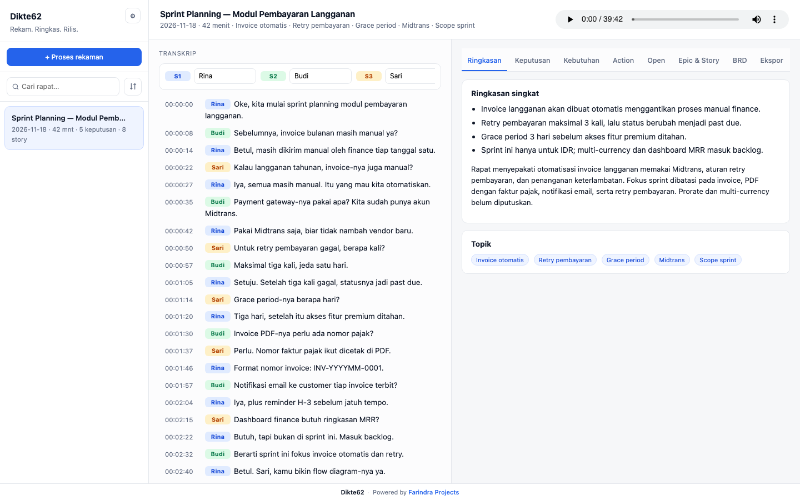
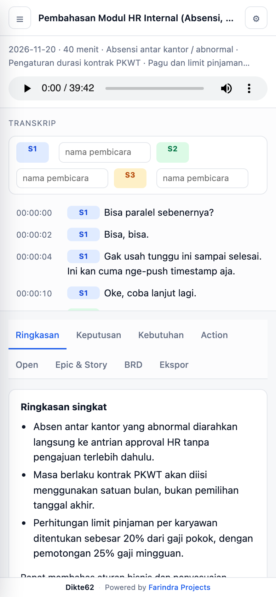
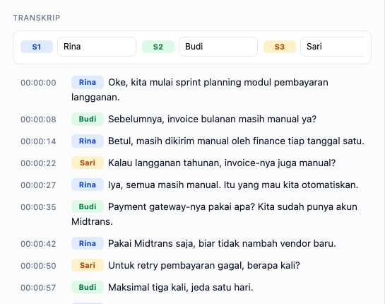
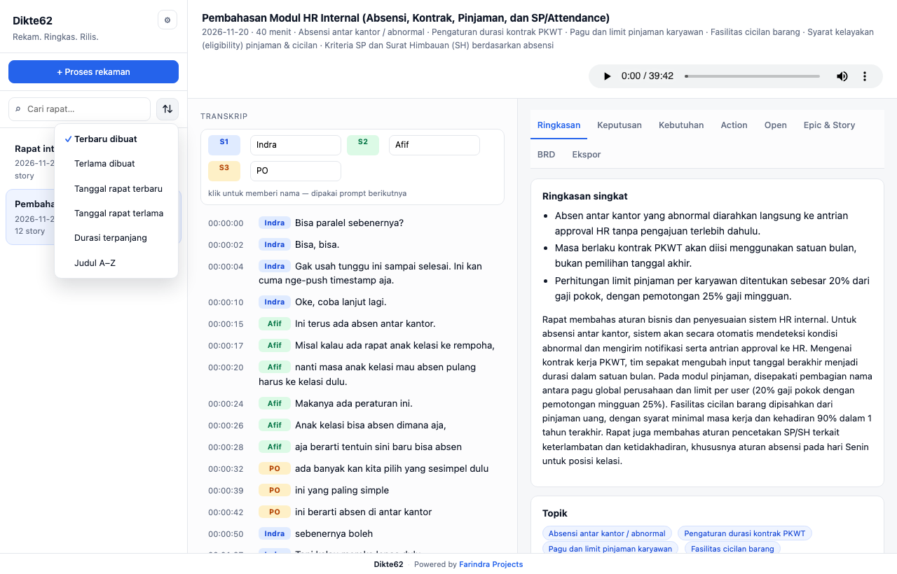

<div align="center">

# Dikte62

**Rekam. Ringkas. Rilis.**

Turn meeting recordings into grounded decisions, BRDs, epics, and Jira-ready user stories.
Local-first: audio never leaves the machine.

[](https://github.com/farindra/dikte62)
[](https://www.python.org/)
[](https://github.com/farindra/dikte62/actions/workflows/ci.yml)
[](LICENSE)
[](#privacy)
[](#)



</div>

---

## Why

Most meeting assistants stop at "here is a summary". The work that actually costs you time
starts after: writing the BRD, splitting it into epics, writing acceptance criteria, and getting
it into Jira.

Dikte62 closes that gap:

- **Audio stays local.** Transcription and speaker labelling run on your Mac.
- **Every statement is grounded.** Decisions, requirements, and action items carry a timestamp
  and a quote from the transcript. If the meeting did not say it, it is not in the document.
- **Nothing is invented.** Items without evidence are pushed into a *needs confirmation* list
  instead of being made up.
- **You approve before it ships.** A review screen pairs the transcript with the generated
  artefacts, and audio playback jumps to the exact moment of each citation.

## What it does

| Stage | Output |
|---|---|
| Transcribe | Indonesian / English, timestamped segments, hallucination-resistant |
| Label speakers | `S1…Sn` via voice embeddings, renameable to real names |
| Extract facts | Decisions, requirements, action items, open questions — each with evidence |
| Generate | BRD, epics, user stories with Given/When/Then acceptance criteria |
| Review | Side-by-side UI, click a citation to hear the moment, approve per document |
| Deliver | DOCX, Markdown, Jira CSV, or direct Jira REST push |

## How it works

```
                       ┌────────────────────── everything local ──────────────────────┐
 audio (.mp3/.m4a/…)   │  faster-whisper (Metal/MPS)  →  speaker diarization (ECAPA)   │
      │                └──────────────────────────────┬───────────────────────────────┘
      ▼                                               ▼
  UI upload ──► job queue ──► transcript + speaker labels (618 segments in ~15 min for 40 min audio)
                                     │
                                     ▼
                          grounded fact extraction  ──►  BRD / Epics / Stories
                                     │                          │
                                     ▼                          ▼
                       evidence-linked JSON  ──►  review UI  ──►  DOCX · CSV · Jira API
```

Design rule: **the JSON is the source of truth**; Markdown, DOCX, and Jira are renderings of it.
Every artefact keeps the model and prompt version that produced it.

## Screenshots

| Review (desktop) | Mobile |
|---|---|
|  |  |

| Speaker labelling | Sorting |
|---|---|
|  |  |

## Quick start

No Homebrew, no sudo, no admin rights: the setup downloads a portable CPython and a static ffmpeg
into the project folder, then creates `.venv/`.

### macOS / Linux

```bash
git clone https://github.com/farindra/dikte62.git
cd dikte62
bash scripts/setup_runtime.sh      # ~4 GB disk, one time
bash scripts/run_ui.sh             # → http://127.0.0.1:8777
```

Optional desktop app (macOS): `.venv/bin/python scripts/build_app.py` → `open Dikte62.app`

### Windows

```bat
git clone https://github.com/farindra/dikte62.git
cd dikte62
setup.bat                          :: unduh runtime + dependensi
run_ui.bat                         :: nyalakan server + buka browser
```

`setup.bat` memakai Python yang sudah terpasang (3.10+) hanya untuk bootstrap; runtime aplikasi
tetap Python 3.12 portabel di dalam folder proyek.

Then: **+ Proses rekaman** → pick an audio file → watch the pipeline → review → export.

## Configuration

Credentials live in the app, not in files you might commit. Open **⚙ Settings**:

| Field | Purpose |
|---|---|
| Gemini API key | fact extraction + document generation |
| Model | `gemini-3.6-flash` / `3.1-flash-lite` / `3.8-flash` / `2.5-pro` |
| Jira: base URL, email, API token, project key | enables “Kirim ke Jira” |
| Epic field | `customfield_10014` for classic projects, empty for team-managed |

Stored in `.data/config.json` (mode `600`, gitignored). The API only ever returns
“configured” plus the last 4 characters — secrets are never sent back to the browser.
Both Gemini and Jira have a **Test connection** button.

No Jira account? Run the bundled mock:

```bash
.venv/bin/python scripts/_mock_jira.py --port 8899   # then set base URL http://127.0.0.1:8899
```

## CLI

Everything the UI does is also a script:

| Script | Purpose |
|---|---|
| `scripts/transcribe_robust.py` | resilient transcription (per-window process, degenerate-output filter, retries) |
| `scripts/diarize.py` | speaker labelling |
| `scripts/extract_facts.py` | transcript → evidence-linked facts JSON |
| `scripts/generate_artifacts.py` | facts → BRD + epics + stories |
| `scripts/render_docs.py` | render Markdown + Jira CSV |
| `scripts/md_to_docx.py` | Markdown → `.docx` |
| `scripts/jira_push.py` | create epics/stories via Jira REST v3 |
| `scripts/run_pipeline.py` | orchestrates everything for one recording |
| `scripts/setup.py` | cross-platform bootstrap (Python portabel + venv + ffmpeg) |
| `scripts/platform_support.py` | device auto-detect (mps/cuda/cpu) + lokasi ffmpeg |
| `scripts/validate_facts.py` | enforces evidence, timestamps, enums, IDs |

Example:

```bash
.venv/bin/python scripts/run_pipeline.py --audio meeting.m4a --jobdir .data/jobs/manual
```

## Engineering notes

Numbers below are measured on an **M1 / 8 GB**, not vendor claims
(details: [`docs/04-hasil-benchmark.md`](docs/04-hasil-benchmark.md)).

| Engine | RTF | Peak RAM |
|---|---|---|
| `openai/whisper` small, CPU fp32 | 0.73 | 1.5 GB |
| `faster-whisper` small, CPU int8 | 0.47 | 0.9 GB |
| `faster-whisper` small, MPS fp16 | 1.10 | 0.4 GB |
| **`faster-whisper` large-v3-turbo, MPS, process-per-window** | **2.57** | < 1 GB |

Two non-obvious failures shaped the design:

1. **Whisper degenerates on MPS after ~4 calls in one process** — the 5th call produced `!!!!!!`
   even for audio that transcribed correctly moments earlier. Fixed by running each window in a
   fresh process ([`docs/05`](docs/05-uji-rekaman-asli.md)).
2. **Speaker embeddings on MPS are broken** — they collapsed into a 99.9 % / 0.1 % split.
   Forcing CPU and switching from agglomerative clustering to k-means fixed it
   ([`docs/06`](docs/06-diarisasi.md)).

Diarization quality is honest about its limits: silhouette 0.19–0.31, short turns can be
misattributed, and overlapping speech is not handled.

## Requirements

| | |
|---|---|
| OS | macOS 13+ · Windows 10/11 (x64/ARM64) · Linux (x64/ARM64) |
| CPU | Apple Silicon (Metal), NVIDIA (CUDA), atau CPU murni |
| RAM | 8 GB minimum (16 GB comfortable) |
| Disk | ~4 GB for runtime + models (`small` 461 MB, `turbo` 1.5 GB) |
| Network | only for LLM/Jira; transcription is fully offline |

Known pitfall: `faster-whisper 1.2.1` is **incompatible with PyAV 19** — `requirements.txt`
pins `av==16.0.1`.

## Web mode (LAN / self-host)

The UI is already a web app; the desktop `.app` only wraps it. To serve it to other devices:

```bash
# on the machine that runs the models
.venv/bin/python scripts/server.py --host 0.0.0.0 --port 8777 --token RAHASIA
```

Open `http://<ip-mesin>:8777/?token=RAHASIA` from any browser on the network. The token is stored
as an HttpOnly cookie after the first visit; requests without it get `401`. Do not bind to
`0.0.0.0` without a token — that would expose the app to anyone who can reach the host.

Docker (Linux host, CPU inference):

```bash
docker build -t dikte62 .
docker run --rm -p 8777:8777 -v dikte62-data:/app/.data \
  dikte62 python scripts/server.py --host 0.0.0.0 --token RAHASIA
```

Audio never leaves the host in either mode; only the browser view is remote.

## Privacy

- Audio and transcripts never leave the machine; only text is sent to the LLM, and only when you
  generate documents.
- No telemetry, no analytics, no cloud storage.
- Server binds to `127.0.0.1` only.
- “Hapus permanen” removes the meeting folder and its audio in one action.

## Limitations

- Speaker diarization is heuristic (not pyannote-grade) and does not handle overlapping speech.
- Document generation needs a Gemini API key; without it the app still transcribes, labels, and
  exports SRT/TXT.
- No PRD/Confluence/Linear exporters yet.
- The `.app` bundle is macOS-only; Windows/Linux use the browser via `run_ui.bat` / `run_ui.sh`.
- No GPU acceleration on Windows yet for SpeechBrain embeddings (diarization runs on CPU).
- Docker image is CPU-only and not yet built in CI.

## Roadmap

- Real-time capture (mic + system audio)
- PRD and Confluence/Notion exporters
- LLM-based de-duplication for multi-pass extraction
- Optional local LLM (Ollama) for sensitive meetings
- Tauri shell and signed `.dmg`

## Project structure

```
scripts/            pipeline, server, exporters, benchmarks, setup.py
run_ui.bat          launcher Windows
setup.bat           bootstrap Windows
Dockerfile          mode web (self-host)
ui/                 local review UI (vanilla HTML/CSS/JS)
prompts/            versioned prompts (extract@v1, artifacts@v1)
schema/             facts JSON schema
docs/               analysis, benchmarks, engineering notes (Indonesian)
schema + prompts    are intentionally plain files: reviewable and diffable
```

## Credits

Built by **[Farindra Projects](https://farindra.com)**.

Standing on the shoulders of: [OpenAI Whisper](https://github.com/openai/whisper) (MIT),
[faster-whisper](https://github.com/SYSTRAN/faster-whisper) (MIT),
[SpeechBrain](https://speechbrain.github.io/) (Apache-2.0), [PyAV](https://pyav.org/) (BSD-3),
[python-docx](https://python-docx.readthedocs.io/) (MIT).

## License

[MIT](LICENSE) © 2026 Farindra Projects
